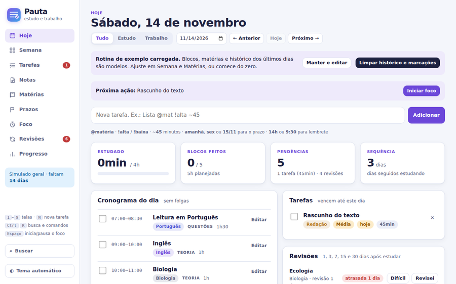
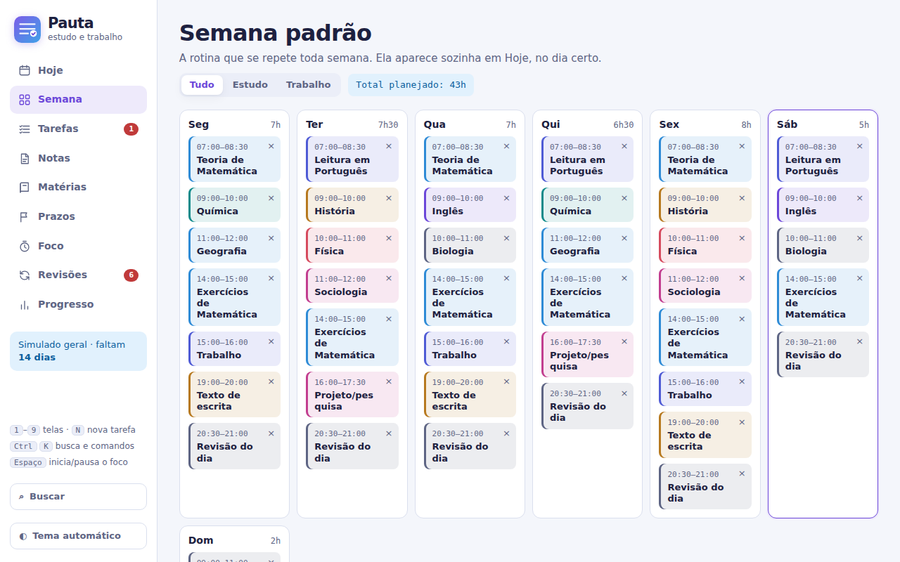
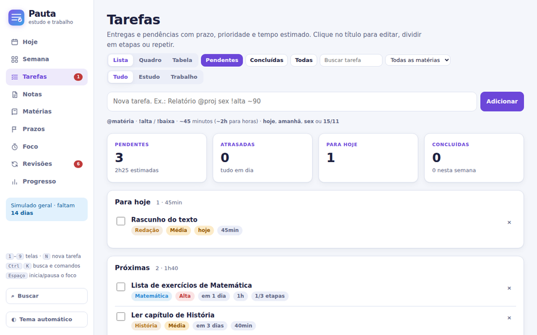
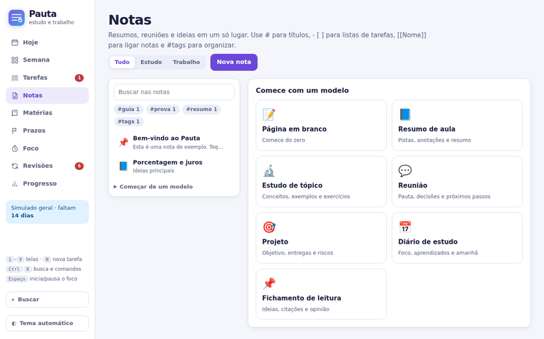
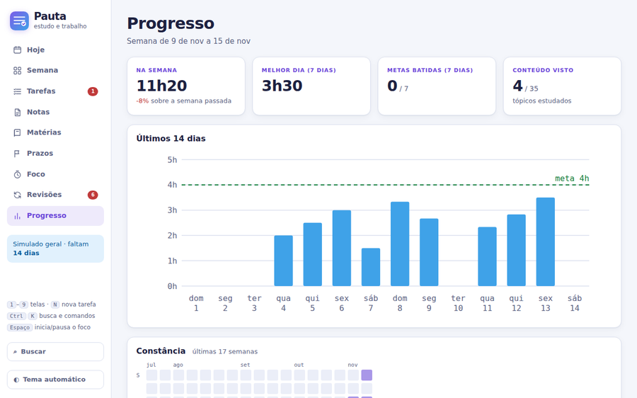
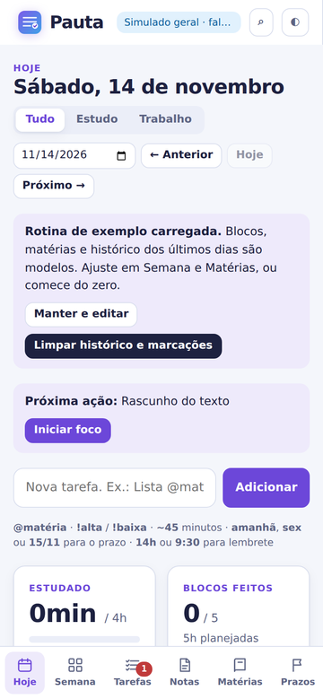
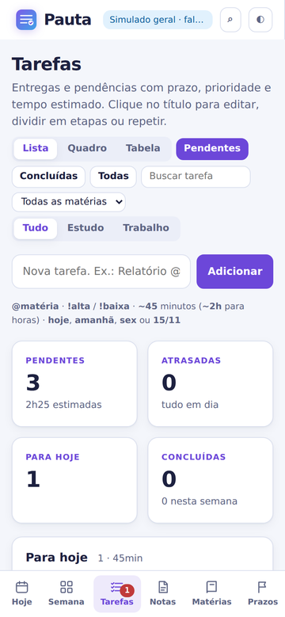
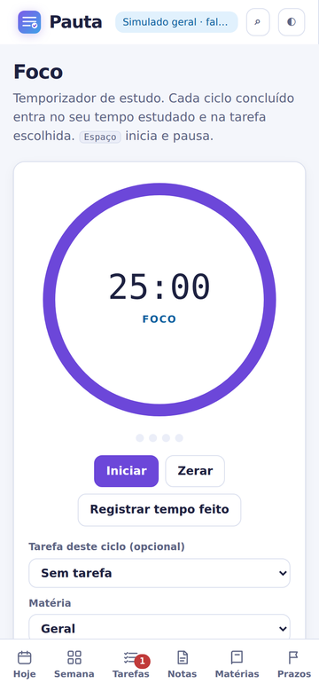

<div align="center">

# 📌 Pauta
### estudo e trabalho

**Rotina semanal, tarefas, notas, prazos, temporizador de foco, revisões espaçadas e progresso, tudo no mesmo lugar.**
Roda no navegador: sem cadastro e sem servidor. Seus dados ficam no seu aparelho.

[](https://arabiano0301.github.io/pauta/)




</div>

---

## ✨ O que tem dentro

| | |
|---|---|
| 📅 **Hoje** | O cronograma do dia, a próxima ação, tarefas com prazo, revisões do dia e a sequência de dias estudados. |
| 🗓️ **Semana padrão** | A rotina que se repete toda semana, separada em Estudo e Trabalho. Ela aparece sozinha em *Hoje*, no dia certo. |
| ✅ **Tarefas** | Lista, quadro ou tabela, com prazo, prioridade, tempo estimado, etapas e repetição. |
| 📝 **Notas** | Resumos, reuniões e ideias com `#` para títulos, `- [ ]` para listas, `[[Nome]]` para ligar notas e `#tags`. Já traz modelos prontos. |
| 📚 **Matérias e conteúdo** | Marque um tópico como estudado e as revisões de **1, 3, 7, 15 e 30 dias** entram na agenda. |
| 🔁 **Revisões espaçadas** | Rever aos poucos fixa muito mais do que estudar tudo de uma vez. |
| ⏰ **Prazos** | Calendário com provas, entregas e reuniões. |
| ⏱️ **Foco** | Temporizador de estudo; cada ciclo entra no seu tempo estudado e na tarefa escolhida. |
| 📊 **Progresso** | Tempo por semana, melhor dia, metas batidas, conteúdo visto e constância das últimas semanas. |

**Atalhos:** `1` a `9` trocam de tela · `N` cria uma tarefa · `Ctrl` + `K` abre a busca e os comandos · `Espaço` inicia e pausa o foco.

## 📱 Telas

<div align="center">


<br>


<br>



</div>

## 🚀 Como usar

- **Online:** abra o link do botão **Abrir o app** acima.
- **No computador:** baixe o repositório e dê dois cliques em `index.html`.
- **No celular:** abra o link no navegador e use *Adicionar à tela inicial*.

Na primeira vez, o Pauta carrega uma **rotina de exemplo**. Ajuste em *Semana* e *Matérias*, ou apague tudo e comece do zero.

## 💾 Seus dados

- Tudo é salvo no **`localStorage`** do seu navegador, no seu aparelho.
- Você pode **exportar o histórico em CSV** e fazer **cópia de segurança** dos dados.
- Em navegadores compatíveis, dá para manter os dados em um **arquivo** no seu computador.
- **Sincronização opcional entre aparelhos:** usa um *Gist* privado do **seu** GitHub, com um token criado por você.
  Veja os cuidados em [SECURITY.md](SECURITY.md).

## 🔒 Privacidade e segurança

- Sem cadastro, sem anúncios e sem rastreamento.
- A única conexão feita pelo app, além das fontes, é a sincronização opcional com a API do GitHub.
- O `index.html` traz uma **Content-Security-Policy** que só permite conexão com `api.github.com`.
- As fontes (Plus Jakarta Sans e JetBrains Mono) são carregadas do **Google Fonts**, então o Google pode ver o endereço IP de quem abre o site.

## 🧱 Tecnologia

Um único arquivo `index.html` (cerca de 180 KB) em **HTML + CSS + JavaScript puro**, sem frameworks e sem etapa de build.

```
pauta/
├── index.html        # o aplicativo inteiro
├── docs/img/         # capturas de tela
├── LICENSE           # MIT
├── SECURITY.md
└── README.md
```

## 🤝 Contribuindo

Achou um erro ou tem uma ideia? Abra uma [issue](../../issues) com o print e o local.

## 📄 Licença

[MIT](LICENSE) © 2026 Arabiano0301
